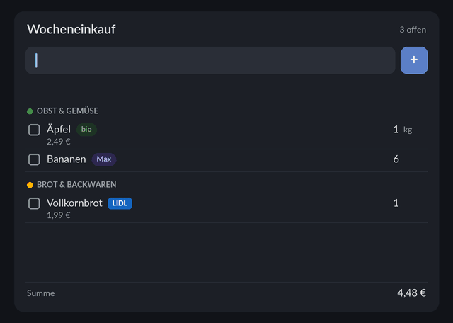

<p align="center"></p>

# SmartLists – Einkaufslisten für Home Assistant

[](https://hacs.xyz/)
[](https://github.com/m3m0rex/ha_smartlists/releases)

[](LICENSE)

[English](README.md) · **Deutsch** · [Webseite](https://ha-smartlists.com/) · [Wiki](https://github.com/m3m0rex/ha_smartlists/wiki) · [Änderungen](CHANGELOG.md) · [Sicherheit](SECURITY.md)

Ein Eingabefeld erkennt Menge, Größe, Preis, Markt, Person und Kategorie und sortiert wie im Markt. Für die ganze Familie, ohne Cloud und ohne Konto – als Dashboard-Karte, als eigene Seite in der Seitenleiste und per Sprache.

<p align="center"></p>

Zum Ausprobieren ohne Installation: Auf [ha-smartlists.com](https://ha-smartlists.com/) kannst du Artikel eintippen und siehst sofort, was SmartLists daraus macht.

## Das Wichtigste

- **Ein Feld, alles erkannt:** `Milch 2x 1l @REWE *Anna #bio` wird zu **2× Milch 1 l** mit Markt-, Personen- und Schlagwort-Badge in der Kategorie Kühlung. Die Zeichen `@`, `*` und `#` legst du selbst fest.
- **Listen kombinieren:** Die Listen von Anna und Max werden zu einer gemeinsamen Liste – jede bleibt eine normale `todo.*`-Entität.
- **Einkaufsmodus:** große Zeilen, Gänge in der Reihenfolge deines Markts, offline nutzbar.
- **Teilen:** per Link und QR-Code ohne Konto in Home Assistant – mit Passwort, Laufzeit und Rechten.
- **Angebote:** Die mitgelieferte Karte zeigt, was von deiner Liste gerade im Angebot ist – und wo am günstigsten.
- **Lernt mit:** Kategorien, Vorschläge und „Häufig gekauft“ je Liste, in sechs Sprachen.

<table>
<tr>
<td width="62%" valign="top"><br><sub>Die eigene Seite in der Seitenleiste.</sub></td>
<td width="38%" valign="top" align="center"><br><sub>Einkaufsmodus am Smartphone.</sub></td>
</tr>
</table>

## Neu in 4.0 (Beta)

- **Neues Listen-Design:** Anzahl und Größe fest markiert, getönte Kategorien zum Einklappen, Badges unter dem Namen.
- **Angebots-Karte `custom:smartdiscounts-card`:** Supermarkt-Angebote, abgeglichen mit deiner Liste, mit Merkliste und Benachrichtigung. Sie gehört seit 4.0.0-beta.7 nicht mehr zu SmartLists und wird über HACS aus ihrem [eigenen Repository](https://github.com/m3m0rex/ha_smartdiscounts-card) installiert (Typ *Dashboard*); fehlt sie, weist SmartLists unter *Einstellungen → Reparaturen* darauf hin.
- **Angebote in der Einkaufsliste:** Hinweis 🏷️ am Artikel, abgelaufene Angebote mit einem Tipp entfernen.
- **Preise:** Währung wählbar (auch eigenes Symbol), Preis-Verlauf je Artikel, automatisches Eintragen abschaltbar.
- **Merkliste:** Produkte merken und benachrichtigt werden, sobald sie im Angebot sind – auch ohne geöffnetes Dashboard.
- **Teilen:** Links nachträglich bearbeiten – Rechte, Laufzeit, Passwort.
- **Einstellungen:** neu gegliedert, Reihenfolge der Badges einstellbar, bessere Ansicht am Smartphone.

Alle Änderungen: [CHANGELOG.md](CHANGELOG.md) · Umstieg von 3.9: [Wiki → Neu in 4.0](https://github.com/m3m0rex/ha_smartlists/wiki/DE-Neu-in-4.0). Betas erscheinen in HACS nur mit **„Beta-Versionen anzeigen“**.

## Installation

1. HACS → ⋮ → *Benutzerdefinierte Repositories* → `https://github.com/m3m0rex/ha_smartlists`, Typ **Integration**
2. **SmartLists** herunterladen und Home Assistant neu starten
3. *Einstellungen → Geräte & Dienste → Integration hinzufügen* → **SmartLists**
4. Dem Einrichtungs-Assistenten folgen (Listen, Märkte, Sprache, Extras)

Die Karten werden automatisch geladen – eine Dashboard-Ressource ist nicht nötig. Voraussetzung: Home Assistant 2025.3 oder neuer. Ausführlich und manuell: [Wiki → Installation](https://github.com/m3m0rex/ha_smartlists/wiki/Installation).

## Die Karten

| Karte | Wofür | Mehr |
|---|---|---|
| `custom:smartlists-card` | Liste, Einkaufsmodus, Einstellungen | [Wiki → Card](https://github.com/m3m0rex/ha_smartlists/wiki/Card) |
| `custom:smartdiscounts-card` | Angebote, abgeglichen mit der Liste | [Wiki → Angebots-Karte](https://github.com/m3m0rex/ha_smartlists/wiki/DE-Angebots-Karte) |

```yaml
type: custom:smartlists-card
entity: todo.einkauf
```

Ohne Dashboard geht es auch: Die Seite **SmartLists** in der Seitenleiste zeigt alle Listen. Und weil jede Liste eine echte `todo.*`-Entität ist, funktionieren die Startbildschirm-Widgets der Home-Assistant-App, Assist und Automationen.

## Weiterlesen

| Thema | Wiki-Seite (Englisch) |
|---|---|
| Eingabe, Badges, Namenskonvention | [Item text and naming convention](https://github.com/m3m0rex/ha_smartlists/wiki/Item-text-and-naming-convention) |
| Kategorien, Vorschläge, einfache Listen | [Categories and suggestions](https://github.com/m3m0rex/ha_smartlists/wiki/Categories-and-suggestions) |
| Eigene Listen, Rechte, Teilen per Link | [Own lists and sharing](https://github.com/m3m0rex/ha_smartlists/wiki/Own-lists-and-sharing) |
| Angebote, Preise, Währung | [Angebote und Preise](https://github.com/m3m0rex/ha_smartlists/wiki/DE-Angebote-und-Preise) (Deutsch) |
| Gang-Reihenfolge, Vorlagen, Wochenplan | [Shopping helpers](https://github.com/m3m0rex/ha_smartlists/wiki/Shopping-helpers) |
| Sprache, Automationen, Blueprints | [Automations and voice](https://github.com/m3m0rex/ha_smartlists/wiki/Automations-and-voice) |
| Alle Einstellungen | [Settings](https://github.com/m3m0rex/ha_smartlists/wiki/Settings) |
| Wenn etwas nicht klappt | [Troubleshooting](https://github.com/m3m0rex/ha_smartlists/wiki/Troubleshooting) |

> Die Android-App **HA SmartLists** ist noch nicht veröffentlicht. Alles hier Beschriebene funktioniert ohne sie.

## Empfohlene Integrationen – Dank an FaserF

SmartLists bringt selbst keine Angebots-Daten mit: Sie zeigt, was Sensoren in deinem Home Assistant liefern. Dafür
empfehlen wir die Integrationen von [FaserF](https://github.com/FaserF) – vielen Dank für diese Arbeit! Alle seine Projekte:
[hassio-addons.fabiseitz.de](https://hassio-addons.fabiseitz.de/)

| | Integration | Was sie liefert |
|---|---|---|
| 🏷️ | [ha-grocery-deals](https://github.com/FaserF/ha-grocery-deals) | Preisvergleich über mehrere Märkte: fasst die Markt-Integrationen zusammen |
| 🔴 | [ha-rewe](https://github.com/FaserF/ha-rewe) | REWE: Wochenangebote, Bonuspunkte und Rabatte |
| 🟡 | [ha-edeka](https://github.com/FaserF/ha-edeka) | EDEKA: Wochenangebote, Rabatte und PAYBACK-Karte |
| 🔵 | [ha-lidl](https://github.com/FaserF/ha-lidl) | Lidl Plus: Wochenangebote, Coupons und digitale Kassenbons |
| ⚪ | [ha-aldi](https://github.com/FaserF/ha-aldi) | ALDI Süd und ALDI Nord: Wochenprospekte |
| 🔴 | [ha-norma](https://github.com/FaserF/ha-norma) | Norma: Wochenangebote und Prospekt |
| 🔴 | *[ha-penny](https://github.com/FaserF/ha-penny)* | *PENNY: digitale Kassenbons (eBons) und Treuepunkte – bisher ohne Prospekt-Angebote* |

SmartLists ist ein eigenständiges Projekt und nicht mit FaserF oder den genannten Märkten verbunden.

## Mitmachen

Fehler und Wünsche bitte als [Issue](https://github.com/m3m0rex/ha_smartlists/issues). Für Entwickler: Die Karte wird in `src/card/` bearbeitet und mit `python scripts/build_card.py` gebaut, die Tests laufen mit `pytest`. Details: [Wiki → Development](https://github.com/m3m0rex/ha_smartlists/wiki/Development).

## Lizenz

MIT – siehe [LICENSE](LICENSE). Die Android-App HA SmartLists ist ein eigenes Projekt mit eigener Lizenz.
