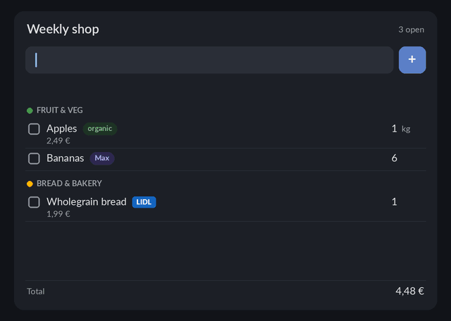

<p align="center"></p>

# SmartLists – shopping lists for Home Assistant

[](https://hacs.xyz/)
[](https://github.com/m3m0rex/ha_smartlists/releases)

[](LICENSE)

**English** · [Deutsch](README.de.md) · [Website](https://ha-smartlists.com/) · [Wiki](https://github.com/m3m0rex/ha_smartlists/wiki) · [Changelog](CHANGELOG.md) · [Security](SECURITY.md)

One input field recognises quantity, size, price, store, person and category and sorts like the store does. For the whole family, without a cloud and without an account – as a dashboard card, as its own sidebar page and by voice.

<p align="center"></p>

To try it without installing: on [ha-smartlists.com](https://ha-smartlists.com/) you can type items and see right away what SmartLists makes of them.

## Highlights

- **One field, everything recognised:** `Milk 2x 1l @REWE *Anna #organic` becomes **2× Milk 1 l** with store, person and tag badges in the category Chilled. You choose the characters `@`, `*` and `#` yourself.
- **Combine lists:** Anna's and Max's lists become one shared list – each stays a regular `todo.*` entity.
- **Shopping mode:** large rows, aisles in the order of your store, usable offline.
- **Share:** by link and QR code without a Home Assistant account – with password, duration and rights.
- **Offers:** the bundled card shows what on your list is on offer right now – and where it is cheapest.
- **Learns along:** categories, suggestions and “bought often” per list, in six languages.

<table>
<tr>
<td width="62%" valign="top"><br><sub>Its own page in the sidebar.</sub></td>
<td width="38%" valign="top" align="center"><br><sub>Shopping mode on the smartphone.</sub></td>
</tr>
</table>

## New in 4.0 (beta)

- **New list design:** count and size clearly marked, tinted categories that collapse, badges below the name.
- **Offers card `custom:smartdiscounts-card`:** supermarket offers matched with your list, with a watch list and notifications – also [available on its own](https://github.com/m3m0rex/ha_smartdiscounts-card).
- **Offers in the shopping list:** a 🏷️ hint on the item, expired offers removed with one tap.
- **Prices:** choose your currency (or your own symbol), price history per item, automatic fill-in can be switched off.
- **Sharing:** edit links afterwards – rights, duration, password.
- **Settings:** restructured, badge order adjustable, better view on the smartphone.

All changes: [CHANGELOG.md](CHANGELOG.md) · coming from 3.9: [Wiki → New in 4.0](https://github.com/m3m0rex/ha_smartlists/wiki/New-in-4.0). Betas only show up in HACS with **“Show beta versions”** switched on.

## Installation

1. HACS → ⋮ → *Custom repositories* → `https://github.com/m3m0rex/ha_smartlists`, type **Integration**
2. Download **SmartLists** and restart Home Assistant
3. *Settings → Devices & services → Add integration* → **SmartLists**
4. Follow the setup assistant (lists, stores, language, extras)

The cards are loaded automatically – no dashboard resource needed. Requires Home Assistant 2025.3 or newer. In detail and manually: [Wiki → Installation](https://github.com/m3m0rex/ha_smartlists/wiki/Installation).

## The cards

| Card | What for | More |
|---|---|---|
| `custom:smartlists-card` | List, shopping mode, settings | [Wiki → Card](https://github.com/m3m0rex/ha_smartlists/wiki/Card) |
| `custom:smartdiscounts-card` | Offers matched with the list | [Wiki → Offers card](https://github.com/m3m0rex/ha_smartlists/wiki/Offers-card) |

```yaml
type: custom:smartlists-card
entity: todo.shopping
```

It also works without a dashboard: the **SmartLists** page in the sidebar shows all lists. And because every list is a real `todo.*` entity, the home-screen widgets of the Home Assistant app, Assist and automations just work.

## Read on

| Topic | Wiki page |
|---|---|
| Input, badges, naming convention | [Item text and naming convention](https://github.com/m3m0rex/ha_smartlists/wiki/Item-text-and-naming-convention) |
| Categories, suggestions, plain lists | [Categories and suggestions](https://github.com/m3m0rex/ha_smartlists/wiki/Categories-and-suggestions) |
| Own lists, rights, sharing by link | [Own lists and sharing](https://github.com/m3m0rex/ha_smartlists/wiki/Own-lists-and-sharing) |
| Offers, prices, currency | [Offers and prices](https://github.com/m3m0rex/ha_smartlists/wiki/Offers-and-prices) |
| Aisle order, templates, meal plan | [Shopping helpers](https://github.com/m3m0rex/ha_smartlists/wiki/Shopping-helpers) |
| Voice, automations, blueprints | [Automations and voice](https://github.com/m3m0rex/ha_smartlists/wiki/Automations-and-voice) |
| All settings | [Settings](https://github.com/m3m0rex/ha_smartlists/wiki/Settings) |
| When something does not work | [Troubleshooting](https://github.com/m3m0rex/ha_smartlists/wiki/Troubleshooting) |

> The Android app **HA SmartLists** is not published yet. Everything described here works without it.

## Contributing

Bugs and wishes as an [issue](https://github.com/m3m0rex/ha_smartlists/issues), please. For developers: the card is edited in `src/card/` and built with `python scripts/build_card.py`; the tests run with `pytest`. Details: [Wiki → Development](https://github.com/m3m0rex/ha_smartlists/wiki/Development).

## License

MIT – see [LICENSE](LICENSE). The HA SmartLists Android app is a separate project with its own license.
