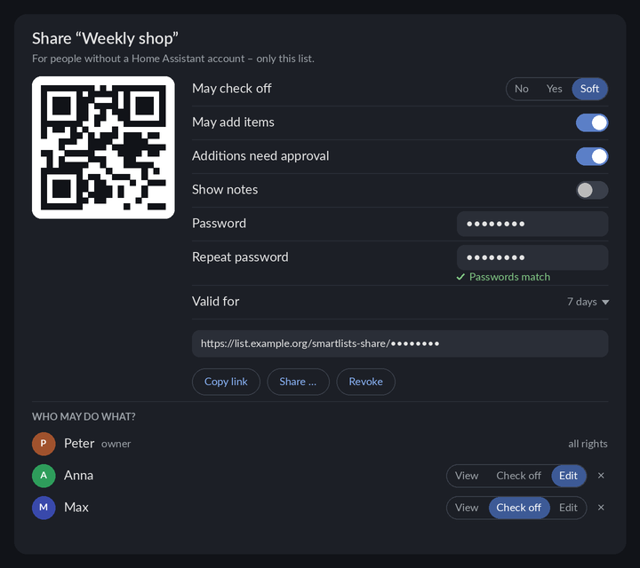
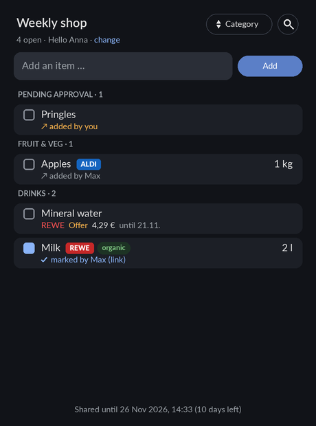

# Categories and suggestions

Every item gets a shopping category (🥬 fruit & veg, 🥛 chilled, …) in this order:

1. **remembered** – chosen by hand for this item
2. **learned** – chosen for a similar item ("Hafermilch" → also "Hafermilch Barista")
3. **keyword packs** – the active packs (see below)
4. **other**

Change the category in the card (tap the chip while typing, or long press → *Change category*). It
applies to all users and is synced with the app. Remembered categories can be changed afterwards in
*Global → Categories*.

**Suggestions** while typing come from the history (frequent and recent items), the list itself and
the products of the active packs (about 1,050 in the German pack), including the usual or last used unit. An empty input shows
"frequently bought" items that are not on the list.

History and "frequently bought" are **per list** by default: what you buy in the pet list does not show up in
the grocery list. A combined list shows what was bought in its source lists. Switch a list to *from all lists*
in its settings (*⋯ → Settings of this list → Bought often & suggestions*). A **plain list** (same place) remembers
nothing at all and suggests nothing – for lists like the hardware store whose items should never appear elsewhere. Categories can be switched off per
list there as well (*Categories automatically*).

Manage everything in the general settings (*Global → Categories*) or in the card's gear menu.

## Keyword packs

A pack maps keywords to the 12 fixed categories. Built in:

| Pack | Keywords | Products |
|---|---|---|
| German – HA SmartLists app | ~6,500 | 1,049 (with usual unit) |
| English / French / Spanish / Italian / Polish – starter packs | ~360–410 each | ~200 each |

By default the pack in Home Assistant's language is active (German if there is none). Admins manage
packs in the general settings → **Global → Categories** (activate packs, add or remove keywords, create a pack,
paste a pack as JSON):

- **switch** a pack on or off – several can be active, e.g. German + English in a bilingual household,
- **▲** moves a pack up: on equal keywords the pack higher up wins. Otherwise the **longest matching
  keyword** wins across all packs ("oat milk" beats "milk"),
- **✏️** edits a pack's keywords: search, change the category, delete, add (several at once,
  separated by commas). Built-in packs stay untouched – your changes go into an add-on pack
  "<name> +" right above it, so updates of the integration never overwrite them. On a built-in keyword
  × means *ignore* (counts as Other); on a changed one it reverts your change,
- **＋ New pack** creates an empty pack, e.g. for another language – then fill it with ✏️,
- **⬇** downloads a pack (built-in ones including your additions) – a good starting point to share,
- **Upload pack …** adds your own pack (JSON). It is activated at the top. The same name replaces an
  existing custom pack; up to 20 custom packs.

Remembered and learned categories always take precedence over every pack.

### Pack format

```json
{
  "name": "My pack",
  "language": "en",
  "version": 1,
  "terms": { "oat milk": "kuehlung", "sourdough": "backwaren", "dish soap": "haushalt" },
  "products": [["Oat milk", "l", "kuehlung"], ["Sourdough bread", "", "backwaren"]]
}
```

- `terms` (required): keyword → category id. Matching is case-insensitive and finds the keyword
  anywhere in the item name ("milk" also matches "oat milk 2 l").
- `products` (optional): `[display name, usual unit, category id]` – used for suggestions and the
  usual unit.
- Category ids: `obst_gemuese`, `fleisch`, `kuehlung`, `grundnahrung`, `backwaren`, `getraenke`,
  `suessigkeiten`, `haushalt`, `drogerie`, `tiefkuehl`, `tierbedarf`, `sonstiges`.
- The app's format (`category_pack_v2.json` with `items` / `keyword` / `aliases` / `category`) is
  accepted as well. Entries with an unknown category are skipped and counted.
- Up to 50,000 keywords per pack. Custom packs are stored in `.storage/smartlists.packs`.

Want to improve a starter pack? The sources are simple word lists in `scripts/packsrc/<language>.py`
(`python scripts/build_starter_packs.py` rebuilds `packs/*.json`) – pull requests welcome.

## Shared memory

Shared by all lists and all HA users, stored in `.storage/smartlists.learning`:

- **Remembered categories:** once an item is assigned to a category by hand, similar items follow
  ("Hafermilch" → chilled also matches "Hafermilch Barista" later). Order as in the app:
  remembered > learned > built-in pack > other.
- **History & suggestions:** frequently and recently bought items, items on the list and the
  products of the app's pack, plus the last used or usual unit. **Per list** by default (a combined list shows
  what was bought in its source lists); switchable to *from all lists* in the list's settings.
- **Plain list:** a list such as "Hardware store" can be marked as *plain list* – no categories, no suggestions,
  and SmartLists remembers nothing from it, so "wood" never shows up in another list. Categories alone can also
  be switched off per list.
- **Naming convention:** `@REWE` becomes a store badge (known stores in their brand colour), `*Anna`
  a person, `#organic` a tag. Admins choose which character means what. Tags stay in the item name,
  so other interfaces still show them as text.
- **Automations & voice:** "I'm at the store" notification, store reminder, recurring items, Assist sentences – see the [wiki](https://github.com/m3m0rex/ha_smartlists/wiki/Automations-and-voice).
- **Own lists with sharing:** lists with an owner, shared per person to view, check off or edit; existing to-do lists can be taken over with all items – see the [wiki](https://github.com/m3m0rex/ha_smartlists/wiki/Own-lists-and-sharing).
- **Connected devices:** every device with the app appears under *Settings → Global → Devices and notes* and as an HA device with *Last seen* and *App version* sensors.
- **Controls:** default for everyone (admin) → per user → optionally per device.
- **Shopping helpers:** aisle order per store/branch, prices & monthly expenses, templates/recipes with
  servings, barcode scan (Open Food Facts), statistics, notifications when others add items (to any notify service, notify entity or custom service such as Telegram), and
  **sharing a list via link or QR code** for people without an HA account – see the
  [wiki](https://github.com/m3m0rex/ha_smartlists/wiki/Shopping-helpers).
- **Select several items** to move, copy, check off or delete them at once; prices typed into the item
  text (`Milk 2 l 1,19€ @REWE`) are recognised.
- **Meal plan** (optional, *Settings → Global → Extras*; also as a tab on the sidebar page) with a calendar entity and optional **Mealie** import, **history per item**, a one-click
  **shopping dashboard** (one sub-page per list), **diagnostics** download and hints under **Repairs**.
- **Sharing:** with people in Home Assistant (view, check off, edit) or **via link / QR code** – only this list,
  limited in time, revocable. Links can go through a **Cloudflare Quick Tunnel, a Cloudflare Tunnel with a fixed address on your own domain or
  your own proxy** instead of
  your Home Assistant address, so nobody you share with learns that address – see the
  [wiki](https://github.com/m3m0rex/ha_smartlists/wiki/Shopping-helpers#share-without-revealing-your-home-assistant-address).
  The share window (gear of the list) has the QR code, *May check off: No · Yes · Soft*, *May add items*, *Show notes*,
  an optional **password** (entered twice) and the validity, plus **"Who may do what?"** for people in Home Assistant
  (only people you add get access). People opening a link enter their name once, so your list shows "marked by Max
  (link)"; the shared page has search, sorting, offers and shows how long it is still shared. While a link is active
  the header shows 🌐 *shared on the web*; tap 👥 *shared* to see who it is shared with:

  

  <table><tr>
<td width="60%" valign="top"><br><sub>Share window – rights, password and "Who may do what?".</sub></td>
<td width="40%" valign="top"><br><sub>Shared page for people without an account.</sub></td>
</tr></table>

- **Settings in one place:** general settings with areas (*For me*, *Global* for admins, *Insights*) and a
  separate settings window per list – see the [wiki](https://github.com/m3m0rex/ha_smartlists/wiki/Settings).

  

Quantities are stored in the name, as in the app ("Milch 2 l @REWE"). "2 kg apples" is recognised
while typing, too.

**Extras – optional, off for beginners:** **notes** (note lists as their own 📝 section), the **meal plan** and
**statistics and expenses** are not needed to get started. The setup assistant leaves them off; switch them on any time under
*Settings → Global → Extras*.
