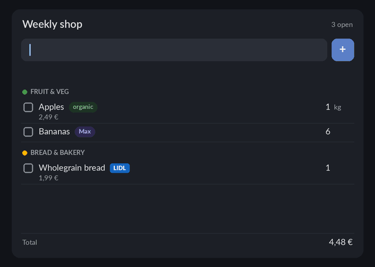

# SmartLists

**SmartLists** turns Home Assistant's to-do lists into real shopping lists: combine several lists into
one, sort by shopping category, show quantities, store badges (`@REWE`), persons (`*Anna`) and offers (the characters are configurable),
and use a shopping mode – in a Lovelace card, on its own sidebar page and in the HA SmartLists app.

📱 **Works directly with the official Home Assistant home-screen widgets** (Android and iOS): every list is a
real `todo.*` entity, so the companion app's To-do list widget can show it – see
[Card](Card#home-screen-widgets). The sidebar page can also be saved as an **app icon** on the home screen
(see [[Sidebar page]]).

**New in 4.0 (beta):** a new list design, the offers card `custom:smartdiscounts-card`, offers and expired offers
right in the shopping list, a selectable currency, a price history and editable share links – see
[[New in 4.0]] and the [changelog](https://github.com/m3m0rex/ha_smartlists/blob/main/CHANGELOG.md).

> ℹ️ **The HA SmartLists Android app is not published yet.** SmartLists works fully without it (Home Assistant,
> card, sidebar page, official Home Assistant app and widgets). Pages and sections about the app – pairing,
> connected devices, app notes, lists from the app – apply once it is available.

## Pages

- [[New in 4.0]] – for everyone coming from 3.9
- [[Installation]]
- [[Setup]] – setup assistant, combined lists, start from scratch
- [[Settings]] – general settings, settings per list, permissions
- [[Own lists and sharing]] – lists with owner and per-person rights
- [[Card]] – `custom:smartlists-card`, all options and presets
- [[Sidebar page]] – one or several lists, app icon for the home screen
- [[Item text and naming convention]] – quantities, `@store`, `*person`, `#tag` (characters configurable), offers
- [[Categories and suggestions]] – keyword packs, suggestions per list, plain lists
- [[Automations and voice]] – "I'm at the store", store reminder, Assist, due items
- [[App pairing and devices]] – for the HA SmartLists app (not published yet)
- [[Shopping helpers]] – aisle order, prices, templates, share via link (tunnel/proxy), meal plan, notifications
- [[Offers card]] – `custom:smartdiscounts-card`, all options, own sensors, watch list
- [[Offers and prices]] – where a price comes from, currency, price history, expired offers
- [[Troubleshooting]]
- [[Development]] – building the card, tests, releases, structure

🌐 Website: [ha-smartlists.com](https://ha-smartlists.com/) – overview of the integration and the Android app.

> This wiki is generated from [`docs/wiki`](https://github.com/m3m0rex/ha_smartlists/tree/main/docs/wiki)
> in the repository and updated automatically with every change. Edits made directly in the wiki are
> overwritten – please open an issue or pull request instead.
