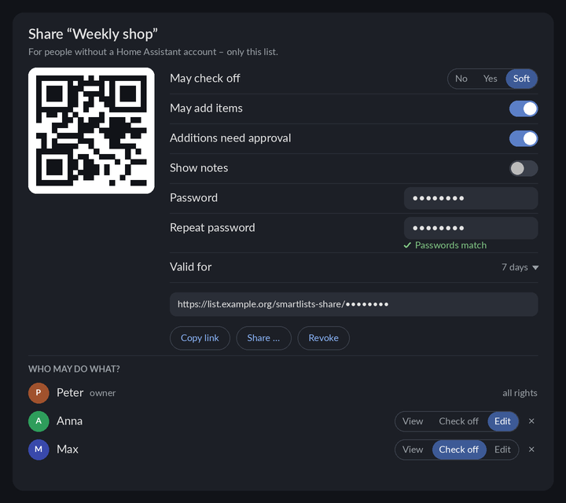
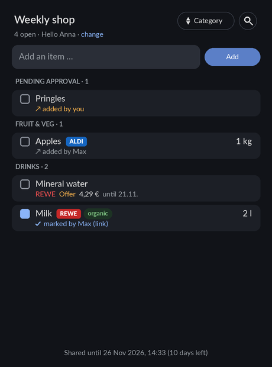

# Shopping helpers

All of these are optional – without settings SmartLists behaves as before.

## Aisle order per store

*General settings → Global → Stores & zones → 🛤️ Order* next to a store. Drag the rows by the handle ⠿
(mouse, finger or pen) or move them with ▲▼ into the order of the aisles. If the store has several zones (branches), choose a
branch to give it its own order. In **shopping mode**, when that store is selected (by hand or
automatically through its zone), the list is grouped in this order.

## Prices & expenses

- **Price of an item:** type it at the end – `Milk 2 l 1,19€` (the price is not part of the name), or
  ✏️ → *Price*. A typed price is for the whole line (`Milk 2 l 1,19€` = 2 l for 1,19 €) and is stored
  **per unit** (0,60 €/l), so other quantities are calculated correctly; in ✏️ you enter the price per
  unit. Offers from the app bring their own price.
- The row shows the total and the unit price; a **total** bar below the list shows open and in-cart sums.
- **Expenses** are booked when an item with a price is **checked off** in the card or the sidebar page
  (re-opening within 6 hours takes it back). *General settings → Statistics → Expenses* shows weeks,
  months or years per store; `sensor.smartlists_expenses_this_month` has the current month.
- Items checked off directly in the app or HA's own to-do view are not booked yet.
- **Shopping done** next to the total sets the "in cart" sum back to 0 (expenses stay booked); optionally
  it reopens everything checked for lists you reuse every week.

## Templates & recipes

*⋯ → Templates* in the card header opens the templates: tap one to add it – choose servings (quantities are scaled),
untick items you don't need. Items already open on the list get their quantity increased instead of
being added twice. *＋ New template* (one item per line, with quantities and tags), *List as template*
takes the open items. Assist: "Put pancakes on the shopping list" uses the template of that name;
action `smartlists.add_template` does the same in automations.

## Share via link / QR code

 

*Gear of the list (settings of this list) → Share via link*. Who may create links is decided by an admin
under *General settings → Global → Sharing and permissions*: admins only, admins and the list's owner
(default), everyone who may edit the list, or nobody (sharing off). There the admin also sets what a link
may allow at most, the longest validity for users without admin rights, and sees – and can revoke – the
active links of all lists.

- **The share window:** QR code on the left (after creating), on the right **May check off: No · Yes · Soft**
  (*soft*: the person can mark items; you see "✓ marked by Max (link)" but the item stays open until you check it
  off), **May add items**, **Show notes** (notes of the items appear on the shared page; offers always do), an
  optional **password** (entered twice; stored only as a PBKDF2 hash, wrong attempts are slowed down) and **valid**
  for 2 hours, 1 day, 7 days, 30 days or until revoked. Below: the link with *Copy*, *Share*, *Revoke*, the active
  links, and for own lists **"Who may do what?"** – only people you add have access (*view · check off · edit*,
  ✕ removes access); owner and admins always have all rights. Items added via a link are marked
  **🔗 added via link** in your list. Admins set the highest level allowed for users without admin rights
  (*Sharing and permissions → A link may at most*).
- People opening a link that allows checking off or adding have to enter their **first name** first (required,
  remembered long-term on their device – browser storage plus a cookie for the share pages only, about 400 days;
  changeable on the page). It shows in your list as "marked by Max (link)" / "added by Max via link" and in the item
  history, so you can tell several friends with the same link apart.
- **The shared page** greets the person by name ("Hello Anna · change"), has the add field at the top, a 🔍 search,
  a sort menu (*category · store · A–Z · added*, remembered on that device), shows offers (store, price, valid until),
  "🔗 added by Max", and in the footer how long the list is still shared ("Shared until … (10 days left)"). It does
  not reload while someone is typing.
- As long as a link is valid, the list header shows **🌐 shared on the web** (tap it to see or revoke the links).
- You get the link and a **QR code** once; copy or share it. The list shows active links with expiry
  and how often they were opened; **revoke** any time.
- **Security:** the link contains a random 256-bit key; only its SHA-256 hash is stored, so even
  someone reading `.storage` cannot rebuild a link. Without login only two addresses are reachable
  (`/smartlists-share/<key>` and `/api/smartlists/share/<key>`); they return the list name and the
  items with checkmarks – no notes (unless allowed for the link), no remembered prices, no entities, no users, nothing
  else from Home Assistant. Since
  3.9.9 the page shows the items like the card: name, quantity, store/person/tag badges in your colours and
  category groups in store order.
  Writing is limited (30 actions per minute, 120 characters), wrong keys are answered slowly, the page
  is not indexed and cannot be framed. Note lists of the app cannot be shared.
- By default the link uses the external address of Home Assistant (Nabu Casa or your own domain,
  *Settings → System → Network → external URL*) – whoever gets the link learns that address. To avoid
  that, see the next section.

### Share without revealing your Home Assistant address

*General settings → Global → Sharing and permissions → Public address for links* (admins):

| Links via | What happens |
|---|---|
| **Home Assistant address** (default) | The link points to the external URL of Home Assistant. |
| **Own proxy** | The link uses an address of your own. A reverse proxy or tunnel in front of Home Assistant (Cloudflared add-on, Caddy, nginx, Traefik, …) forwards only the share paths to Home Assistant. |

Shared links are always served by Home Assistant itself: SmartLists registers `/smartlists-share/<key>` (the page)
and `/api/smartlists/share/<key>` (its data) without login, protected by the 256-bit key in the link. SmartLists
starts no programs and opens no port of its own. If *Own proxy* is chosen but no address is entered, **no link is
created** – SmartLists never falls back silently to the Home Assistant address.

Let the proxy forward **only these two paths** to Home Assistant (port 8123) and answer everything else with 404,
so the login page and the API of Home Assistant are not reachable under the shared address:

- `/smartlists-share/`
- `/api/smartlists/share/`

If the proxy sends `X-Forwarded-For` (Caddy, nginx with `proxy_set_header`, Cloudflared), Home Assistant has to
trust it, otherwise it answers *400 Bad Request*:

```yaml
http:
  use_x_forwarded_for: true
  trusted_proxies:
    - 172.30.33.0/24   # add-ons on Home Assistant OS, e.g. Cloudflared
    - 192.168.1.20     # your own proxy
```

**Examples** (replace `192.168.1.10` with the IP of Home Assistant):

```caddyfile
liste.example.org {
    @share path /smartlists-share/* /api/smartlists/share/*
    handle @share {
        reverse_proxy 192.168.1.10:8123
    }
    respond 404
}
```

```nginx
server {
    server_name liste.example.org;
    location /smartlists-share/     { proxy_pass http://192.168.1.10:8123; }
    location /api/smartlists/share/ { proxy_pass http://192.168.1.10:8123; }
    location /                      { return 404; }
}
```

Cloudflare Tunnel with your own domain (e.g. the *Cloudflared* add-on or a tunnel managed in the Cloudflare
dashboard): add a public hostname `liste.example.org` with the path `^/(smartlists-share|api/smartlists/share)/`
(a regular expression) and the service `http://homeassistant:8123`; requests that match no rule get Cloudflare's
404. Then enter `https://liste.example.org` as the public address. A sub-path such as `https://example.org/list`
works as well, as long as the proxy strips it.

**Until 4.0.4** SmartLists could start `cloudflared` itself (Quick Tunnel, tunnel with a fixed address) and ran a
share server of its own on port 8126. Both are gone: point the tunnel or proxy at Home Assistant as shown above and
save the setting once – a notice under *Repairs* reminds you until then. A `cloudflared` file in `/config` is no
longer used and can be deleted.

## Notifications

*General settings → For me → Notifications* – everyone for themselves: **where to** (one or more
targets), on new items and/or when something is checked off, which lists, from whom (per person), quiet hours.
Your own changes only notify you if *Also for my own changes* is on (handy to try it out, or when you add
something on the PC and want it on your phone). Several changes within a minute arrive as one message ("Anna
added milk 2 l, bread to Shopping"). Changes from the card, the app, HA itself and shared links count. Messages are sent about a minute after the first change (several changes are combined). If you pick a
combined list, changes in its source lists count too.
*Send test message* checks the device right away – if nothing arrives, check the companion app and its
notification permission; failed messages are logged in *Settings → System → Logs*.

**Targets** (*Send to → ＋ Add target*) – as many as you like, no companion app required:

- **Notification service** – every `notify.*` service: companion app devices (📱), Telegram (`notify.telegram_…`),
  e-mail, Signal, Pushover, groups … – whatever is set up in Home Assistant.
- **Notification entity** – new-style `notify.*` entities (sent with `notify.send_message`).
- **Custom service** (admins) – any service with JSON data, e.g. `telegram_bot.send_message` with
  `{"target": 123456789}` or a `script.*` that does whatever you want. `{title}` and `{message}` in the data
  are replaced; without them `title` and `message` are added.

A failing target does not stop the others; *Send test message* shows which one failed.

## Due dates, reminders and calendar

Item menu → **Due on**. Everyone who may tick items on a list may set this.

- **Date and time**: the time is optional; without one the item counts as due from 09:00.
- **Remind me when it is due**: Home Assistant sends one message when the time has come – to the notification
  targets of whoever switched the reminder on (*General settings → For me → Notifications → Send to*). Without
  targets a notification appears in Home Assistant. Ticked or deleted items are not reminded; a changed date
  reminds again.
- **Repeat**: daily, weekly or monthly. Ticking the item sets its next date; on that day it is opened again and –
  with a reminder – reminds again. Ticked early, it returns one period later.
- **Buttons in the reminder**: on a device with the companion app the reminder has *Done* (ticks the item) and
  *Remind me tomorrow* (moves the due date by one day).
- **Sensor**: `sensor.smartlists_due` counts the open items that are due today or overdue; the items are in the
  attribute `items`, the number of overdue ones in `overdue`. An item ticked outside SmartLists (for example in Home
  Assistant's own to-do view) is noticed when its reminder would be sent.
- **Add to calendar**: enters the item in a Home Assistant calendar that accepts new events (for example *Local
  calendar*). With a time the event lasts 30 minutes, without one it is an all-day event. With several calendars
  you choose one; the choice is remembered on the device. The event moves with a changed date and is removed when
  the item is ticked or deleted; re-opening the item enters it again. Removing only works for calendars that allow
  deleting events – the local calendar does, for others the old event stays.
- In a combined list favourites and due dates are stored with the source list, so they are the same everywhere
  the item appears.

## Barcode scan

The barcode button next to the input opens the scanner. In the Home Assistant companion app (Android/iOS)
its own full-screen scanner is used; in a browser the camera (Chrome) or a field to type the number.
The product name comes from SmartLists' own memory or a lookup service (only the number is sent).

- *For me → Shopping and scanning*: the **target list** (this card's list or any other) and whether a
  scanned product goes into the input field to check or is **added directly**.
- *Global → Voice, backup, defaults*: which **lookup services** in which order – Open Food Facts, Open
  Beauty Facts, Open Pet Food Facts, Open Products Facts, UPCitemdb, or your own (URL with `{code}` and the
  JSON field holding the name). *Look up barcodes online* turns the lookup off altogether.

## Statistics

*Statistics and expenses* is an optional extra (*General settings → Global → Extras*), off in the setup assistant.

📊 on the sidebar page (or *General settings → Statistics*): bought most often with rhythm ("every
4 days"), *not bought for a while* (with ＋ to put it back on the list), shares per category and store.
**Bought means checked off** (since 3.9.11) – items that were only put on the list do not count; checking off and
reopening right away (mistap, undo) does not count either. Check-offs from the item history are added once after the
update. Admins can remove wrong items (×) from the history, **tick several and remove them** or **reset the statistics**
completely (purchases and rhythm – suggestions while typing stay). Under *Bookings* single, **selected** or **all**
expense bookings can be deleted (admins all, others their own).

## Meal plan


The meal plan is an **extra**: switch it on or off under *General settings → Global → Extras* (the setup
assistant leaves it off). Off hides the tab, the menu entry and the calendar; planned dishes are kept.

*⋯ → Meal plan* shows a week (← → for other weeks). Put dishes – i.e. templates – on days. Changes are
kept until you press **Save** (then you are asked whether the ingredients should go on the list) or **Add
ingredients to list** (saves and puts everything of that week on the list; equal items are added up).
Clicking next to the window does not discard changes. The plan is also the calendar
**SmartLists Meal plan** in Home Assistant (for dashboards and automations).

**Mealie:** if the Mealie integration is set up, *Get from Mealie* takes the recipes of the week's Mealie
meal plan: each recipe becomes a template (🍽️) with its ingredients and is entered in the plan.

## Item history

Long press an item → *History*: who added, checked off, reopened, renamed or deleted it, and when – also
changes from the app, Home Assistant, automations ("automation") and shared links. The last 400 changes per
list are kept.

## Shopping dashboard

*General settings → Global → Voice, backup, defaults → Create dashboard* adds a dashboard *Shopping
dashboard* to the sidebar with **one sub-page per list** (its own address, e.g. `/smartlists-shopping/einkauf`;
combined lists first, more than 12 lists share a page "More"), plus the meal plan calendar and statistics if they
are switched on. Creating it again updates it (and replaces your own changes to it). It is a normal dashboard
afterwards – edit or delete it like any other.
